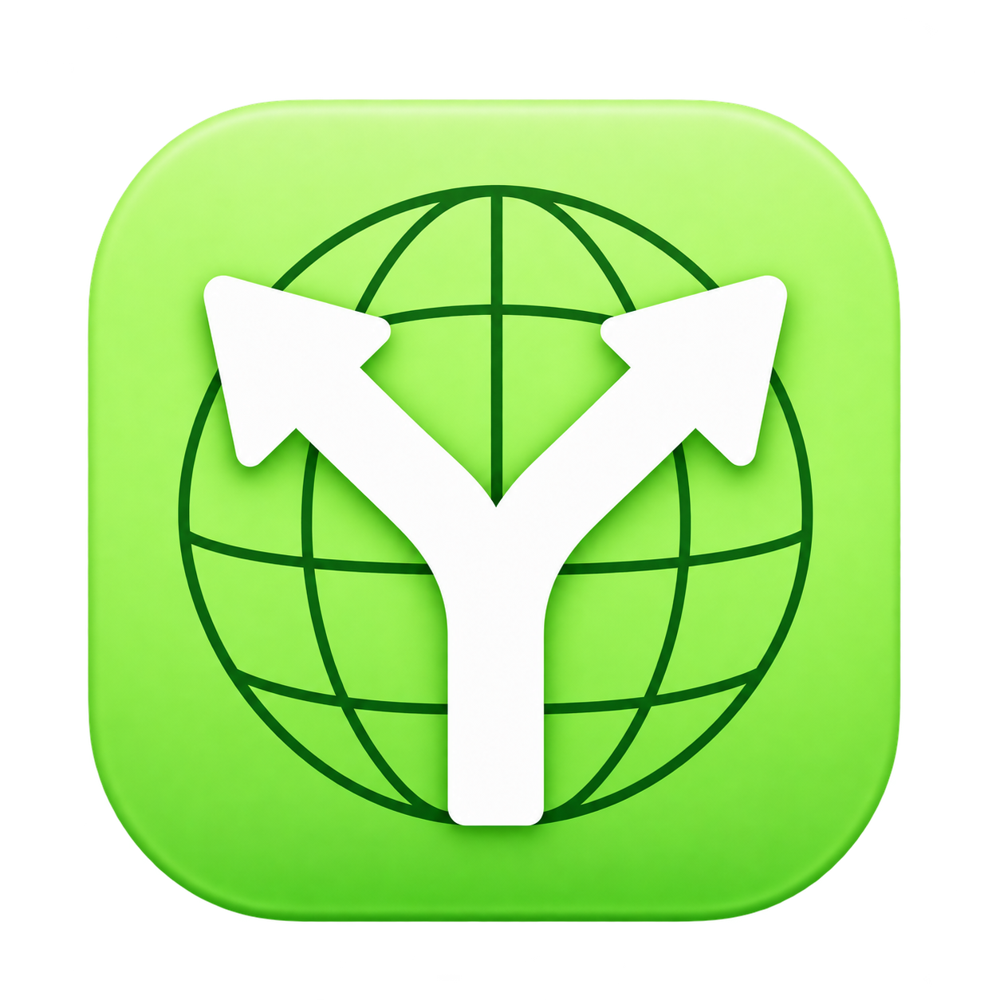
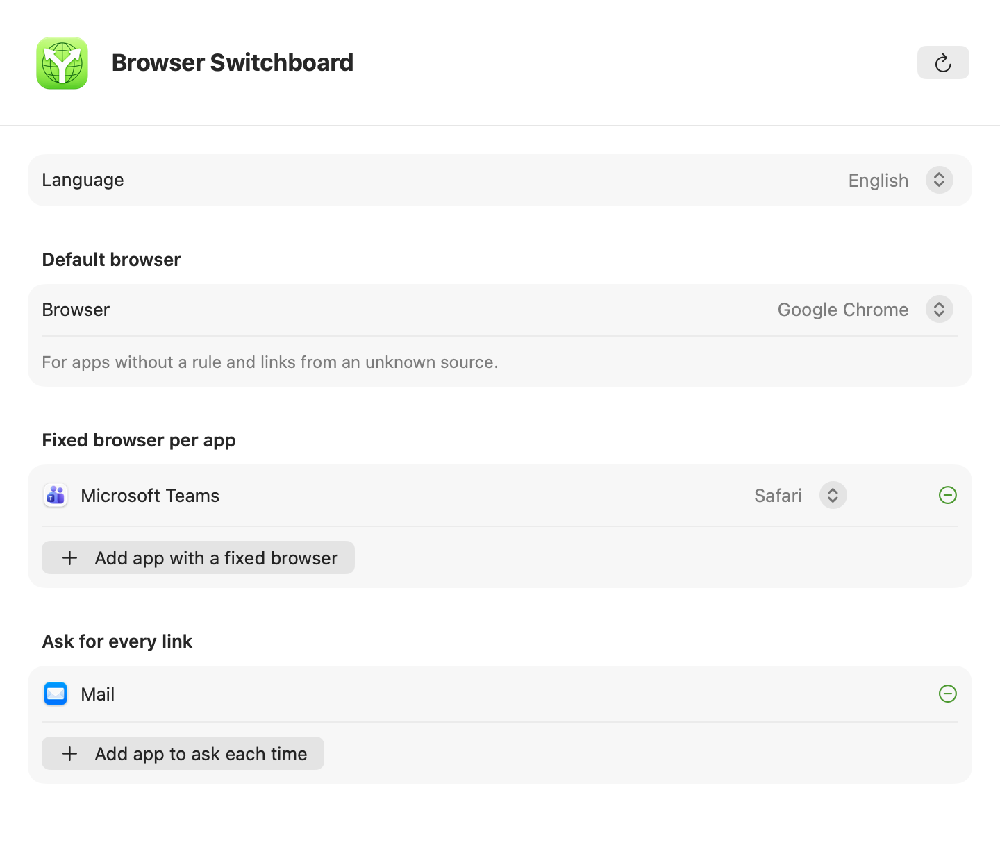

# Browser Switchboard



Choose which browser opens links from each macOS app. Set a default browser, assign a different browser to an app, or have Browser Switchboard ask every time. For example, send Microsoft Teams links to Safari and everything else to Chrome.

[Deutsch](docs/README.de.md)

## Install and configure

Requires macOS 13 or later and at least one installed browser. Choose the download for your Mac: Apple silicon or Intel.

1. Download the app ZIP from [Releases](../../releases) when a signed and notarized build is available. You can also [build it from source](#build-from-source).
2. Extract the ZIP, move **Browser Switchboard.app** to Applications, and open it.
3. Choose the browser that should handle links without an app rule. The app starts with an empty rule list.
4. In **System Settings → Desktop & Dock → Default web browser**, select **Browser Switchboard** so macOS can send it links.

The app follows the preferred supported system language and falls back to English. Choose **Language → English** or **Deutsch** to override it. Settings save immediately. Open the app again in Finder to reopen the settings window.

## Routing modes



*Example configuration. The screenshot shows rules added after first launch.*

| Mode | When to use it | Example |
| --- | --- | --- |
| **Default browser** | You want one browser for links without a matching app rule. | Open everyday links in Chrome. |
| **Fixed browser per app** | Links from a particular app should always go to a different browser. | Open Microsoft Teams links in Safari. |
| **Ask for every link** | You want to decide when you click. | Choose Safari or Chrome each time you open a link from Mail. |

If a rule's browser is missing, the app uses the configured default, then the first available browser. A new rule for the same app replaces its previous rule.

## How routing works

Browser Switchboard receives HTTP and HTTPS events from macOS and opens the link directly in the chosen browser. Rules use the bundle identifier associated with the immediate sender of the Apple event. If a helper or the operating system hands off a link, macOS may expose only the intermediary or no identifiable sender. The fallback browser handles links with an unknown source. Links an app opens internally or sends straight to a browser bypass the switchboard.

The browser list is based on apps registered with macOS for both HTTPS and HTML. Browser Switchboard excludes itself. Settings stay on the Mac. The app does not collect telemetry or log URLs. Local diagnostic logs record the detected app identifier and destination browser.

## Build from source

Install the free Apple Command Line Tools if needed with `xcode-select --install`.

```sh
bash ./build.sh
"build/Browser Switchboard.app/Contents/MacOS/BrowserWeiche" --self-test
```

Open `build/Browser Switchboard.app` in Finder. Use `BUILD_ARCH=universal bash ./build.sh` to build both architectures. The build uses Swift 6, SwiftUI, and AppKit with no third-party packages.

To stop using the app, select another default web browser in System Settings before removing Browser Switchboard.

See [Contributing](CONTRIBUTING.md), the [changelog](CHANGELOG.md), and the [MIT license](LICENSE).


## Support the project

If Browser Switchboard is useful to you, you can [say thanks with a donation via PayPal](https://paypal.me/mrtnbt).
