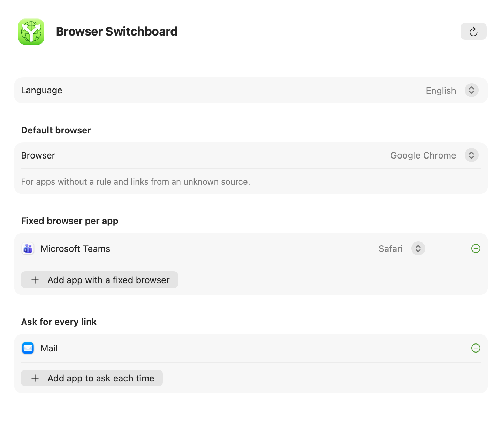

# Browser Switchboard

Browser Switchboard öffnet Links je nach Quell-App im gewünschten Browser. Du kannst einen Standardbrowser wählen, einzelnen Apps einen festen Browser zuweisen oder bei jedem Link nachfragen lassen. Die Beispielkonfiguration leitet Microsoft Teams an Safari und andere Links an Chrome weiter.

[English](../README.md)

## Installieren und einrichten

Voraussetzung ist macOS 13 oder neuer. Wähle das passende Paket für Apple Silicon oder Intel.

1. Lade das App-ZIP unter [Releases](../../../releases) herunter, sobald ein signierter und notariell beglaubigter Build verfügbar ist. Alternativ kannst du die [App aus dem Quellcode bauen](../README.md#build-from-source).
2. Entpacke die ZIP-Datei, verschiebe **Browser Switchboard.app** nach **Programme** und öffne sie.
3. Wähle beim ersten Öffnen deinen Zielbrowser für Links ohne Regel. Die Regelliste ist zunächst leer.
4. Wähle **Browser Switchboard** unter **Systemeinstellungen → Schreibtisch & Dock → Standard-Webbrowser**.

Die App übernimmt die bevorzugte unterstützte Systemsprache. Unter **Sprache** kannst du jederzeit **English** oder **Deutsch** wählen. Änderungen werden sofort gespeichert. Ein erneuter Doppelklick im Finder öffnet die Einstellungen.

## So kannst du die Weiche nutzen

*Beispiel mit nachträglich hinzugefügten Regeln. Die Oberfläche lässt sich auf Deutsch umstellen.*

| Einstellung | Anwendungsfall | Beispiel |
| --- | --- | --- |
| **Standardbrowser der Weiche** | Links ohne eigene App-Regel öffnen. | Alltagslinks in Chrome öffnen. |
| **Fester Browser pro App** | Einen Browser für alle Links einer App festlegen. | Teams-Links immer in Safari öffnen. |
| **Bei jedem Link nachfragen** | Bei jedem Klick selbst entscheiden. | Bei Links aus Mail zwischen Safari und Chrome wählen. |

## Grenzen und Datenschutz

Wenn macOS die Quell-App liefert, verwendet Browser Switchboard ihre Kennung für die Regel. Vermittelt ein Hilfsprozess den Link, kann die ursprüngliche Quelle fehlen. Dann greift der eingestellte Standard. Links, die eine App intern oder direkt in einem Browser öffnet, erreichen Browser Switchboard nicht.

Die App speichert Einstellungen lokal und erhebt keine Telemetrie. Das lokale Diagnoseprotokoll enthält erkannte App-Kennungen und Zielbrowser. Linkadressen werden darin nicht erfasst.

Zur Deinstallation stellst du zuerst in den Systemeinstellungen einen anderen Standardbrowser ein und entfernst anschließend die App.

## Projekt unterstützen

Wenn dir Browser Switchboard hilft, kannst du dich [mit einer Spende über PayPal bedanken](https://paypal.me/mrtnbt).
